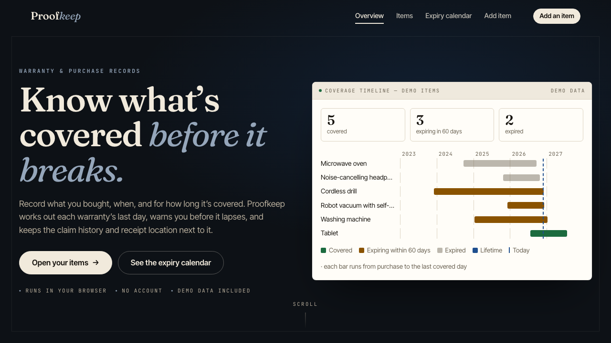
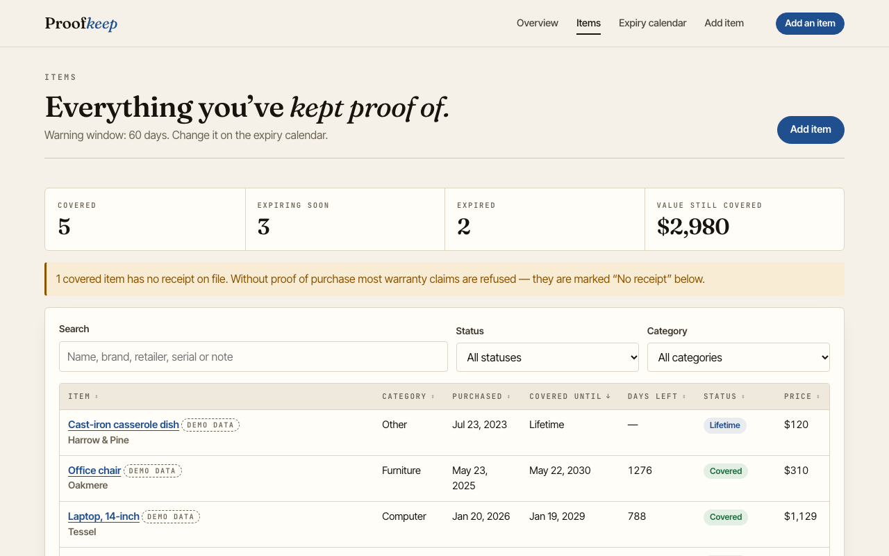
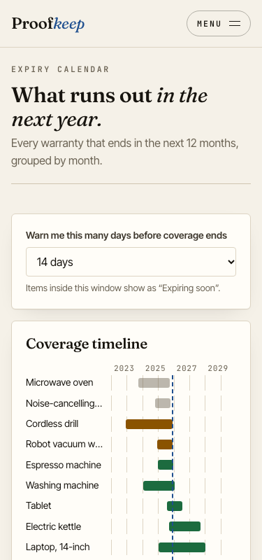

# Proofkeep

Warranty and purchase records that work out each warranty’s last covered day, warn you before it lapses, and keep the claims history and the location of your receipts next to the item.

**Live demo:** [https://warranty-vault.vercel.app/](https://warranty-vault.vercel.app/) — runs entirely in your browser; demo data is fictional and labelled.



| Items | Mobile |
| --- | --- |
|  |  |

## Run it

```bash
npm install
npm run dev        # http://localhost:5205
npm test
npm run build
npm run test:e2e   # Playwright smoke test (npm run e2e:install once if Chromium is missing)
```

## Main workflow

1. The app opens with eleven labelled **demo items** covering every state: covered, expiring soon, expired, lifetime, no warranty, a missing receipt, an open claim and a very long name. **Items → Clear demo items** removes them; the empty state offers to load them again.
2. **Add item** → name, purchase date, price, warranty length and any extended plan. A live preview shows the last covered day while you type.
3. **Items** → summary (covered / expiring / expired / value still covered), search, status and category filters, a sortable and paginated table, CSV export, JSON backup and import.
4. Open an item for its **coverage progress**, purchase details, a documents checklist and a **claims log** with outcomes.
5. **Expiry calendar** → change the warning window (14–120 days), see a coverage timeline for every item and the warranties ending in each of the next 12 months.

## Rules

- Coverage starts on the purchase date. A 12-month warranty bought on 10 March covers up to and including 9 March the following year.
- Month arithmetic clamps to the end of the month (31 January + 1 month → 28/29 February).
- Extended plans add their months after the manufacturer warranty.
- An item is **Expiring soon** when its last day is within the warning window, and **Expired** from the day after.
- “Value still covered” sums the price of items that are covered, expiring or lifetime.
- Importing a backup replaces current items only if the whole file validates; otherwise nothing changes.

## Design

Shared editorial system: Fraunces display type with italic accents, Inter Tight interface text, mono labels, an ink hero whose preview is the real timeline component rendering demo data, and a warm paper workspace. The timeline has year gridlines, a today marker, a legend and tooltips on hover or keyboard focus. Motion (staggered hero, bars growing in sequence, scroll reveals, route cross-fades) is disabled under `prefers-reduced-motion`.

## Tests

- `src/lib/warranty.test.ts` — end dates, month-end clamping, extended plans, status boundaries, coverage used, validation, month grouping, summary, CSV rows, backup parsing.
- `src/App.test.tsx` — demo data, empty state, add with validation, claims, status filter, invalid import.
- `src/shared/*.test.ts` — table sorting/pagination and CSV helpers.
- `e2e/smoke.spec.ts` — landing, sort, add with validation, claim, reload persistence, calendar, plus 375px layout checks.

## Limitations

- No reminders or notifications; the warning only shows inside the app.
- Documents are referenced by location, not uploaded.
- Single currency display (US dollars formatting); no multi-currency totals.
- Data lives in this browser only. Use the JSON backup to move it.

## Future improvements

- Attach a photo of the receipt (stored locally with IndexedDB).
- Calendar (.ics) export of end dates.

## Licence

MIT — see [LICENSE](LICENSE).
